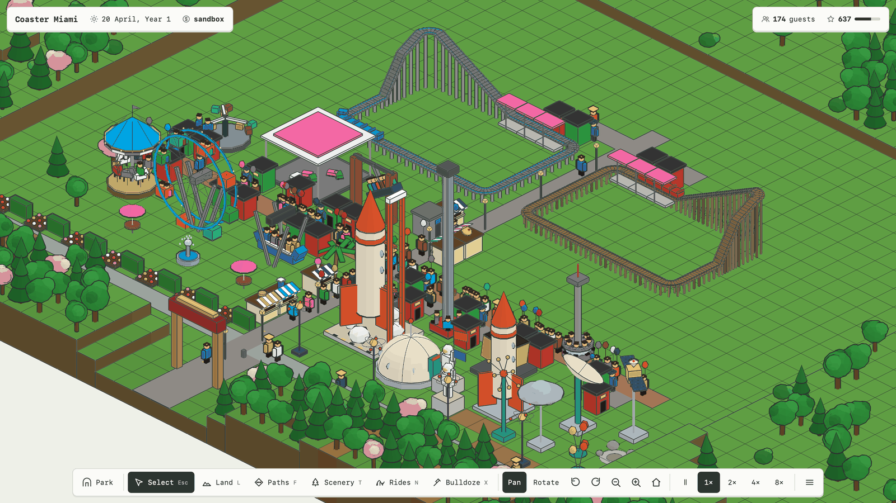
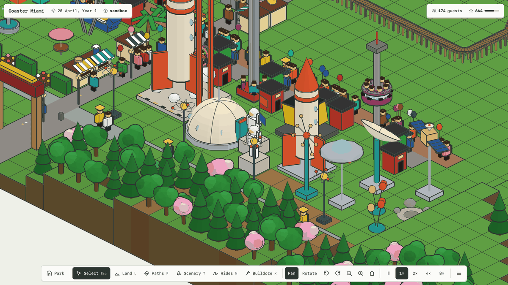
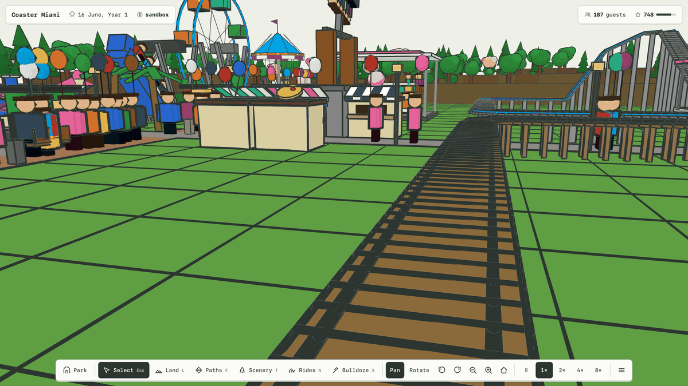
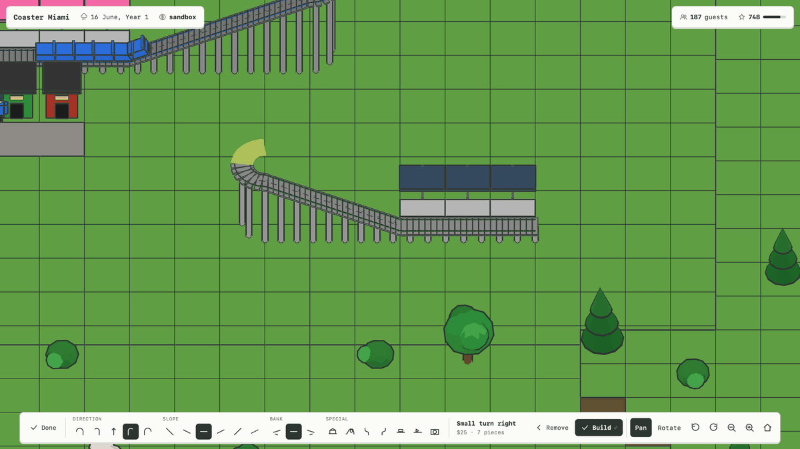
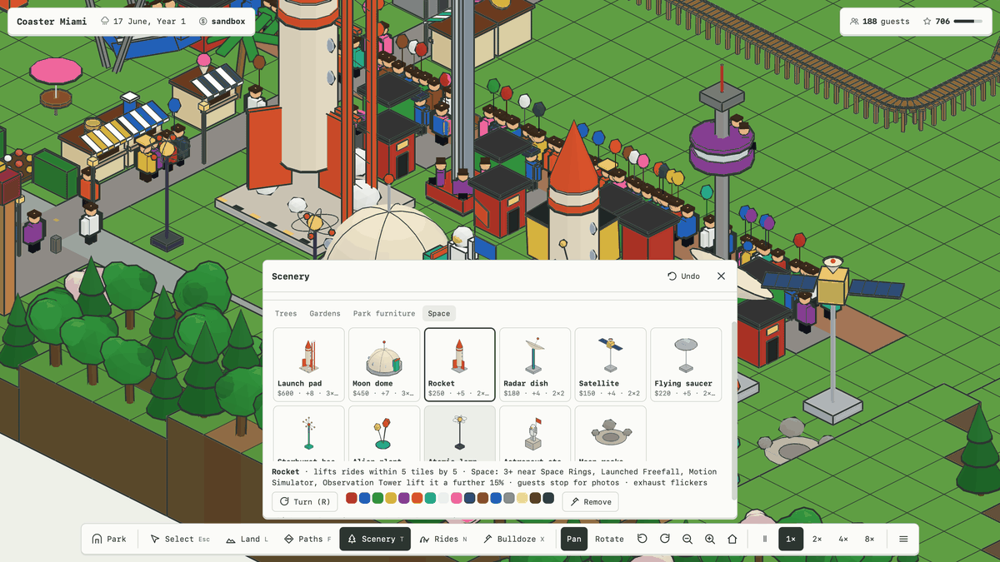
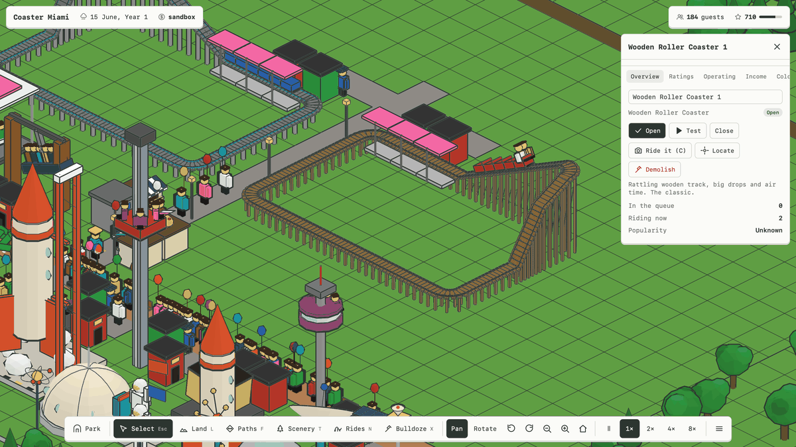
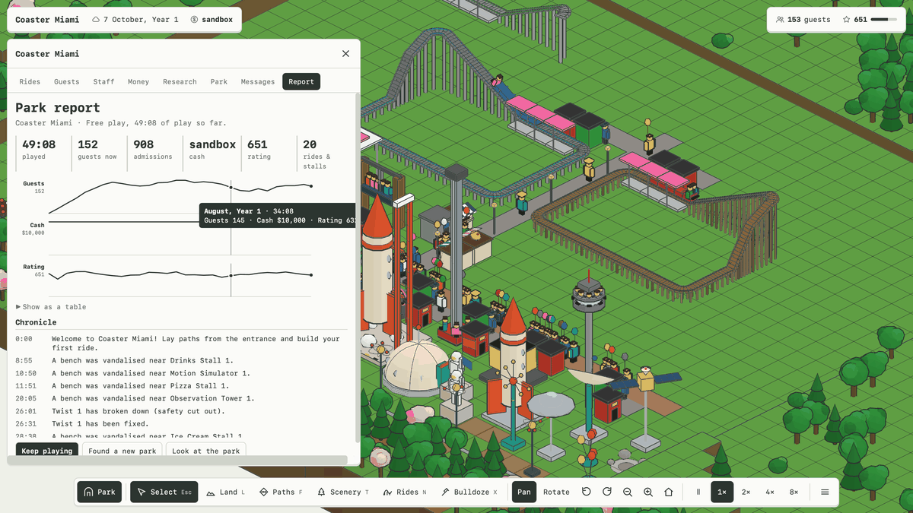
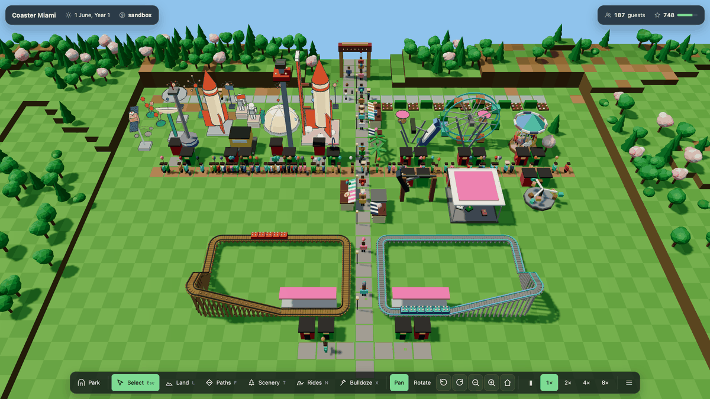
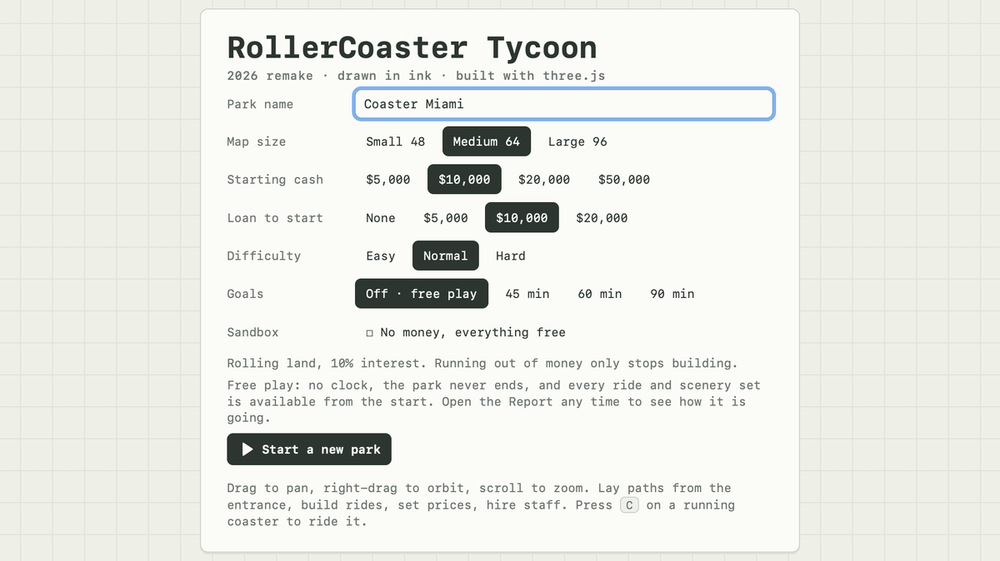

# RollerCoaster Tycoon · 2026 remake



A theme park game in the spirit of the 1999 original, rebuilt as a modern three.js app and drawn in ink: every ride,
stall, tree and guest is a hand-built model with ink lines on its edges, a fixed shade per side and no sun or shadows,
seen through a flat (orthographic) camera you can turn and tilt. The old shaded 3D look is one switch away in Options.
Every model and effect is generated in code; nothing is downloaded. The whole game builds into one HTML file.

## Screenshots

<table>
  <tr>
    <td width="50%"><br><sub><b>Space set.</b> Big pieces at guest scale. Guests stop to take photos, and nearby Space rides earn a theme bonus.</sub></td>
    <td width="50%"><br><sub><b>Ride it.</b> Press <code>C</code> on a running coaster to ride in the front seat.</sub></td>
  </tr>
  <tr>
    <td><br><sub><b>Coaster builder.</b> While you build, the track tools take over the bottom bar: direction, slope, bank, special pieces.</sub></td>
    <td><br><sub><b>Scenery picker.</b> A drawn preview of every piece, with its price, value and size. Drag to paint rows of it.</sub></td>
  </tr>
  <tr>
    <td><br><sub><b>Ride pages.</b> Click any ride to open, test or close it, ride it, read its ratings and income.</sub></td>
    <td><br><sub><b>Park report.</b> Guests, cash and rating on one time axis, plus a chronicle of everything that happened.</sub></td>
  </tr>
  <tr>
    <td><br><sub><b>Classic look.</b> The same park with sun, shadows, night and rain. Options → Look.</sub></td>
    <td><br><sub><b>New park.</b> Free play (everything unlocked), an optional goals clock, or sandbox.</sub></td>
  </tr>
</table>

## Play it

- Double-click `Start RollerCoaster Tycoon.command`, or open `dist/index.html`, or the copy at `~/Desktop/rollercoaster-tycoon.html`.
- The game needs WebGL 2 (any current browser). **Options → Look** switches between the ink look and the classic shaded 3D
  look (sun, shadows, night and rain); the choice is remembered.

**Controls.** Drag to pan, right-drag to orbit, scroll to zoom. `W A S D` / arrows pan, `Q` `E` rotate, `+` `−` zoom.
`P` or space pauses, `1`–`4` set the speed. `R` rotates the thing you are placing, `Esc` cancels. `X` bulldozer, `F` paths,
`T` scenery, `L` land, `N` new ride. While building a coaster: `Enter` builds the piece, `Backspace` removes the last one.
`C` rides the selected coaster in first person. `O` cycles the map overlays, `M` shows or hides the mini-map, `U` sees
through the land (tunnels).
`Cmd+Z` undoes a build, `Cmd+S` opens save & load. `Esc` closes the report and brings the panels back after **Look at the park**.

**How to play.** Lay a path from the entrance and place a ride: with **Auto-connect** (Options, on by default) its
entrance, exit, queue and the path to your park are laid for you and it opens; a stall gets a path to its counter.
Coasters are built piece by piece (sloped turns, helix quarters, loops, corkscrews, block brakes, splashes on water),
**Finish** plans and builds the rest of a circuit back into the station, and the **Ready-made** tab places a whole tested
layout in one click (six coasters, a log flume, river rapids and a park railway). Guests judge each
ride by Excitement, Intensity and Nausea against their own taste. Keep them fed (stalls), relieved (toilets), happy
(scenery, benches, short queues) and the park clean (handymen, bins). Mechanics fix breakdowns. Research unlocks rides.
Ads bring guests. The park rating (0–999) drives how fast guests arrive. Water rides sell best on hot days; the
railway is a ride for everyone and a rest for tired legs.

**Land, water, bridges and tunnels (as in RCT).** The land slopes: raising a tile slopes the land around it one step a
tile, pointing at a tile's corner moves just that corner, and **Cliffs** moves only the tiles under the brush. **Water
up** floods land a step at a time and **Water down** drains it. Paths follow the slope of the land; **Bridge or tunnel**
in the Paths window builds on from a path's height: over low land the path stands on posts, into a hill it becomes a
tunnel (the land is cut back to a wall where it goes in), and two paths can cross on one tile at different heights.

**Seeing what guests think.** The Guests window opens on a **Thoughts board**: every complaint in the park, most common
first, with **Show** (goes to where most of them were) and the usual fix in one click (build food or toilets there, hire
a handyman, set a fair price, open the ride…). The **View** button (`O`, `M`) colours the paths by happiness, litter,
queue length or crowds, shows a mini-map you can click or drag, and turns on money that floats up where it is earned and
thought bubbles over guests. Staff can be given a **patrol area** (painted in 4×4 squares on the map). Now and then a park
event brings more guests (a heatwave, a holiday rush, a school trip, a VIP visit, a glowing review); they only ever help
and can be turned off in Options.

**Tempo.** Normal is the original's pace. **Quick** and **Rapid** (new park screen, or Options) make months two or four
times shorter and bring guests and research three or six times as fast, so a park fills up in minutes.

**Scenarios.** Eight hand-made parks, each with its own land, money, rides to begin with (research brings the rest) and
goals against a clock: Forest Glade, Lakeside Gardens and Boardwalk Bay (Beginner); Canyon Run, Desert Mirage and Island
Hop (Challenging); Thrill Valley and Miami Mega Park (Expert). Meet every goal and hold it for two minutes: three stars
with half the time to spare, two with a quarter, one otherwise. Finishing any park in a tier opens the next.

**Free play or goals.** On the Free play tab parks have no clock and never end. **Goals**
adds a clock (45, 60 or 90 minutes of play) and three targets scaled to the map and difficulty: guests in the park, a
park rating and cash on hand (no cash goal in sandbox). Hold all of them for two minutes and the goals are met; when the
clock runs out the park gets a verdict. Either way you can keep playing.

**The park report** (Report in the dock, or the clock chip in the top bar) shows the run so far: time played, guests,
admissions, cash and rating, the goals, three small charts on one time axis (guests, cash, rating; hover for the values,
or open the table view) and the chronicle of every message with its time. It opens by itself when goals are met or time
runs out, with **Keep playing**, **Found a new park** and **Look at the park** (every panel hidden; `Esc` brings them back).

## Build and test

```
npm install
npm run dev        # vite dev server
npm run build      # one-file build in dist/ + a copy on the Desktop
npm test           # rule tests (vitest): goals, tempo, auto-connect, Finish circuit, every ready-made ride facing all
                   # four ways, the new pieces, block sections, events, patrol areas, water rides, scenarios
node tests/e2e-3d.mjs chromium|webkit [W H]   # the game in a real browser: building, auto-connect, ready-made rides,
                   # overlays, mini-map, pops, the Thoughts board, patrol, scenarios, both looks, goals
# ink-lab.html (dev server only): the same live park drawn Today / Fine ink / Bold ink, for comparing the looks
```

## Layout

- `src/sim/` — the rules, no DOM: map, guests, rides, coaster physics and ratings, money, research, marketing, awards,
  weather, staff (patrol areas), saves, `goals.ts` (the clock and targets, weekly history, the chronicle), `connect.ts`
  (auto-connect), `autotrack.ts` (Finish circuit), `designs.ts` (ready-made rides), `events.ts`, `insights.ts` (the
  Thoughts board), `scenarios.ts`, and `runtime.ts` (per-park lookups that keep big crowds fast; never saved).
  `docs/rct-rules.md` holds the research notes the rules follow.
- `src/ink/` — the ink look: `kit.ts` (a model is a sketch of filled parts, ink outlines and strokes; unlit fills shaded
  by face direction; world-unit ink lines; the styles), `models.ts` (every ride, stall, scenery kind, hut, the gate,
  coasters), `terrain.ts` (ground, cliffs, paths, water in 16×16 patches), `views.ts` (the views the game drives).
- `src/three/` — the classic look's views (terrain, scenery, guests, rides, coasters, rain), and `world.ts`: the renderer,
  both cameras (flat for ink, perspective for classic and the ride camera) and the look switch.
- `src/dock/` — the interface: dock, chips, inspector pages, bottom rail, title screen (scenarios and free play), the
  park report, `floaters.ts` (money pops, thought bubbles), `lens.ts` (map overlays), `minimap.ts`, `progress.ts`
  (scenario stars); `ink.css` is the paper interface used with the ink look.

## Credits

The land, water and path rules (sloped land and its corner heights, water levels, paths at any height and how they join)
follow [OpenRCT2](https://github.com/OpenRCT2/OpenRCT2), the open-source re-implementation of RollerCoaster Tycoon 2,
licensed GPL-3.0 like this game. Only rules and numbers are taken from it: no graphics, sounds, music, scenarios or
objects from either game.

## Left out on purpose

Sound, post effects (bloom, ambient occlusion), touch controls, path slopes steeper than one step, and park events that
hurt (they only ever help).
